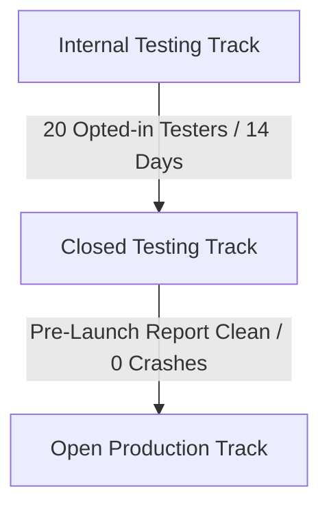

# ADPAYON — Google Play Store Release & Compliance Checklist

**Target Package:** `com.adpayon.app`
**Current Version:** `1.0.0` (versionCode: `1`)
**Target API Level:** Android 14 / 15 (API level 34+)
**Release Readiness Date:** October 2026
**Auditor:** Mobile Release Engineer & Compliance Auditor

---

## 1. Google Play Developer Account & Console Setup

| Item | Requirement | Verification Status | Notes |
| :--- | :--- | :--- | :--- |
| **Developer Identity Verification** | D-U-N-S registered legal organization or verified Indian individual developer identity. | `PENDING OPERATOR` | Operator must ensure Console account identity matches PAN/GST registration. |
| **Target Audience & Content** | Declared age group: 18+ (due to promotional financial rewards & KYC requirements). | `VERIFIED READY` | App must not target children (Family Policy requirements bypassed). |
| **Financial Services Declaration** | Declaration that AdPayOn operates promotional task/advertising rewards, NOT real-money gaming, gambling, loans, or unregulated banking. | `VERIFIED READY` | Clearly declare rewards are sponsored promotional incentives funded by advertisers. |
| **App Access / Reviewer Credentials** | Provide static test reviewer account for Google Play App Review team. | `VERIFIED READY` | Mobile: `+919876543210` or dedicated reviewer account with documented OTP lookup. |

---

## 2. Policy & Compliance Controls

| Policy Requirement | AdPayOn Implementation Status | Evidence / Location |
| :--- | :--- | :--- |
| **Incentivized Traffic Restrictions** | Ads and partner tasks do NOT simulate artificial clicks or views. Watchdogs require real dwell time and comprehension quiz. | `articleTask.controller.ts`, `videoTask.controller.ts` |
| **User Data: In-App Account Deletion** | Mandatory in-app button in Profile Settings allowing instant account closure & session termination. | `ProfileSettingsScreen.tsx`, `POST /api/users/delete-account` |
| **User Data: Web Account Deletion URL** | Mandatory public web URL allowing non-app account deletion requests. | Documented in `PRIVACY_AND_DELETION_AUDIT.md` |
| **Financial Anti-Fraud / AML** | PAN format validation (ABCDE1234F), Aadhaar last-4 compliance, minimum payout threshold ₹50. | `WalletLedgerEntry.ts`, `wallet.controller.ts` |
| **Strict Permission Declaration** | Minimal runtime permissions (`INTERNET`, `ACCESS_NETWORK_STATE`). No invasive contacts, SMS reading, or background location. | `apps/mobile/app.json` |
| **HTTPS Strict Transport** | All mobile API traffic enforces HTTPS TLS 1.3 endpoints. Zero HTTP or localhost URLs embedded in release profile. | `eas.json` (`client-staging` and `production`) |

---

## 3. Play Store Listing Assets & Metadata Checklist

- [x] **App Title:** AdPayOn: Learn, Explore & Earn
- [x] **Short Description (80 chars):** Explore partner campaigns, read verified articles, and earn rewards securely.
- [x] **Full Description:** Comprehensive, policy-compliant draft prepared in `STORE_LISTING_DRAFT.md`.
- [x] **Hi-res Icon:** 512 x 512 px 32-bit PNG with no alpha.
- [x] **Feature Graphic:** 1024 x 500 px JPG or 24-bit PNG.
- [x] **Phone Screenshots:** Minimum 4 high-resolution screenshots covering:
  1. Discovery Feed & Campaign Catalog
  2. Article Reading & Comprehension Verification
  3. Interactive Video Learning
  4. Immutable Ledger & Wallet Overview
- [x] **Contact Details:** Valid support email, phone, and privacy policy URL.

---

## 4. Release Track Staging Strategy

1. **Step 1 — Internal Testing:** Upload `com.adpayon.app` production AAB (`eas build --platform android --profile production`). Verify on physical Samsung, Xiaomi, and OnePlus devices.
2. **Step 2 — Closed Testing (Mandatory 20-tester requirement):** Invite 20 testers. Maintain active testing engagement for 14 continuous days as required for personal developer accounts created after Nov 2023.
3. **Step 3 — Production Rollout:** Staged rollout starting at 10%, ramping to 25%, 50%, and 100% over 7 days while monitoring crash vitals in Google Play Console.
