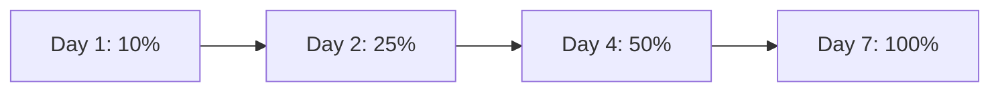

# ADPAYON — Mobile Release & Production Rollback Plan

**Application:** ADPAYON
**Target Package:** `com.adpayon.app`
**API Backend:** Node.js/TypeScript on Render
**Database Cluster:** MongoDB Atlas (`adpayon_production` / `adpayon_client_staging`)

---

## 1. Release Rollback Matrix

| Failure Mode | Trigger / Threshold | Action | Owner | Estimated RTO |
| :--- | :--- | :--- | :--- | :--- |
| **Critical Android App Crash** | Crash-free sessions < 98.0% or immediate ANR on startup | Halt staged rollout in Google Play Console; promote previous stable release. | Mobile Lead | < 15 minutes |
| **Backend API Outage / 500 Spike** | HTTP 5xx error rate > 1.5% over 5 minutes | Rollback Render deployment to previous stable Git commit checkpoint. | Backend Lead | < 5 minutes |
| **Ledger Discrepancy / Over-crediting** | Unreconciled balance or duplicate reward detected | Trigger emergency task pause switch (`isEmergencyPaused = true`) on all campaigns. | Tech Lead | Instant (< 1 min) |
| **Database Migration Corruption** | Schema index failure or unrecoverable write lock | Restore MongoDB Atlas point-in-time backup snapshot. | DBA / Lead | < 30 minutes |

---

## 2. Google Play Console Staged Rollout Rollback Procedure

When deploying an Android update to Production, **never release to 100% immediately**. Use the following schedule:



### Steps to Halt or Roll Back an Android Release:
1. Log in to [Google Play Console](https://play.google.com/console).
2. Select **AdPayOn** (`com.adpayon.app`).
3. Under **Release**, go to **Production** or **Open Testing**.
4. In the **Releases** tab, locate the active release (e.g. Version 1.0.0).
5. Click **Halt rollout**. This immediately freezes updates so no additional users receive the build.
6. If the release has already reached a substantial fraction of users, create an expedited hotfix release with an incremented `versionCode` (e.g. `versionCode: 2`, `version: 1.0.1`), build via EAS, and submit directly to Production.

---

## 3. Backend (Render & MongoDB Atlas) Rollback Procedure

### Render API Rollback:
1. Open Render Dashboard -> `adpayon-client-api` (or production API service).
2. Go to **Deploys**.
3. Identify the last verified stable deploy (e.g. Commit `5d2745ca` or latest verified production commit).
4. Click the three dots `...` next to that deploy and select **Rollback to this deploy**.
5. Render immediately stops the current container and re-activates the verified image within 90 seconds.

### MongoDB Atlas Emergency Checkpoint:
1. Prior to applying schema or indexing changes, trigger an on-demand Atlas snapshot:
   ```bash
   # Atlas CLI or Console
   atlas backups snapshots create --clusterName adpayon-cluster
   ```
2. If corrupt records occur:
   * Restore point-in-time snapshot to an isolated diagnostic cluster `adpayon_recovery`.
   * Replay immutable audit log events (`admin_audit_logs` & `wallet_ledger_entries`) to reconcile balances.

---

## 4. Emergency Kill Switches

The platform features built-in server-side kill switches that do NOT require app rebuilds:

* **Task Engine Kill Switch:**
  * Setting a Campaign status to `'PAUSED'` immediately hides all child tasks from the mobile user feed and rejects any in-flight `/tasks/:id/start` calls.
* **Withdrawal Suspension Switch:**
  * Admin can pause the payout processing queue without interrupting user task completion.
